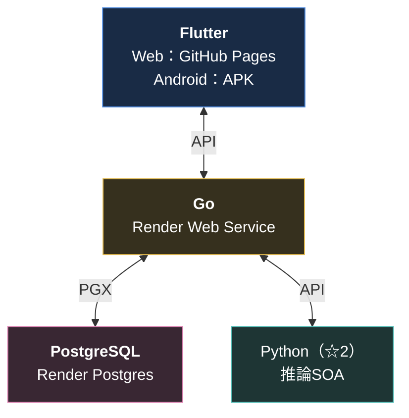

# Watch-Denchi_app

- **☆1**：Version.01
- **☆2**：Version.02（時間に余裕があれば追加する）

## アプリケーションアーキテクチャ

システム設計録：https://battery-design-explorer.tweedygrape8.chatgpt.site

Watch-Denchi_appは、Flutter・Go・PostgreSQLの３層アーキテクチャで構成される。

- **Flutter**：プレゼンテーション層
- **Go**：アプリケーション層（API Server）
- **PostgreSQL**：データベース層



## フォルダ構成

以下は☆1の構成です。☆2は、時間に余裕があれば追加します。

```text
WatchDenchi_app/
├── FRONT/                              ー Flutter（プレゼンテーション層）
│   ├── ・・・         
├── BACK/                               ー Go（アプリケーション層）
│   ├── go.mod                          
│   ├── go.sum                          
│   ├── main.go                         ーー HTTP Server
│   ├── handlers/                       ーー Fultter向けAPI
│   │   ├── create_client.go                ☆1：POST  /api/client
│   │   ├── create_device_battery.go        ☆1：POST  /api/device-battery
│   │   ├── list_device_batteries.go        ☆1：GET   /api/device-battery
│   │   ├── list_predictions.go             ☆2：GET   /api/prediction
│   │   ├── list_batteries.go               ☆1：GET   /api/battery
│   │   ├── select_battery.go               ☆1：PATCH /api/device-battery/{draft_id}
│   │   └── register_battery.go             ☆1：POST  /api/battery
│   └── health/                         ーー CICD向けAPI
│       ├── liveness.go                          GET /healthz
│       ├── liveness_test.go            
│       ├── readiness.go                         GET /readyz
│       └── readiness_test.go           
├── DB/                                 ー PostgreSQL（データベース層）
├── inference/                          ー Python（☆2：推論SOA）
├── docs/                               
├── .github/workflows/                  ー CICD設定
│   ├── flutter.yml                     
│   └── go.yml                          
├── .env.example                        
├── .gitignore                          
├── compose.yaml                        
└── README.md                           
```

- **CI**：`flutter.yml` は `FRONT/` でFlutterの静的解析・テストを実行します。`go.yml` は `BACK/` でGoのテスト・ビルドを実行し、`DB/` のSQLを使ってPostgreSQLとの接続も検証します。
- **CD**：

## API仕様と反映手順

- [主要APIの仕様](docs/api.md)
- [DB変更・Goのデプロイ手順](docs/device-api-deploy.md)
- [Flutter担当者向けの接続指示](docs/flutter-integration.md)
